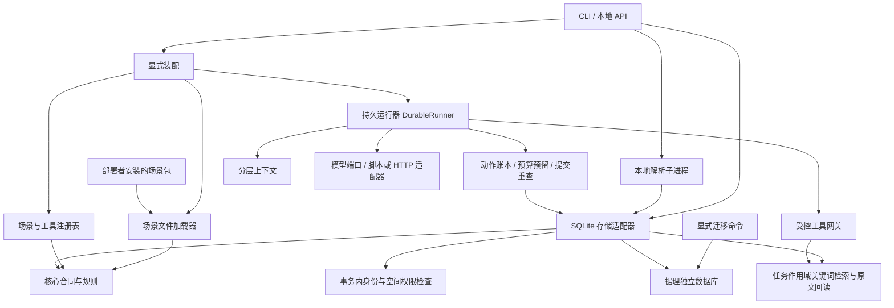

# 当前架构与职责

## 已落地的层次

核心合同使用 Pydantic，结构输出采用本地 JSON Schema 校验。核心不导入 FastAPI、数据库、模型供应商、原报价项目或场景包。

这些箭头表示代码和数据装配关系。实际运行由 API 单动作请求或受信 Python 调用推进；当前没有后台调度服务。

## 六个核心概念

| 概念 | 实现位置 | 目前行为 |
|---|---|---|
| 工作空间 | `core/resources.py` | 主体与空间分离；受信访问上下文检查范围 |
| 资源与版本 | `core/resources.py` | 内容哈希、状态、媒介、来源和版本；角色属于绑定关系 |
| 会话与任务 | `core/tasks.py` | 创建不可变输入快照；通用角色数量和格式校验；状态版本与合法迁移 |
| 证据与结果 | `core/evidence.py` | 原文不去空白；版本/内容哈希/定位校验；引用必须有本任务的回读记录 |
| 工具 | `core/tools.py` | 名称和版本、输入输出 schema、权限要求和重复注册检查 |
| 场景扩展 | `core/scenarios.py` | 固定 API 版本、资源角色、指令、所需工具和结果结构；内容指纹 |

`TaskSnapshot` 中固定的是资源版本与场景包内容，而不是可变文件路径。`ScenarioPackage` 保存已加载文本；修改磁盘文件不会修改已加载对象。同一 ID/version 在一个注册表中不允许被另一个包覆盖，修改已发布包应增加版本。

任何没有绑定到任务的资源不能悄悄出现在任务快照中。同一资源版本允许多角色，使用相同资源的多个版本也可显式绑定，便于将来开发版本对比场景。

## 合同与运行器的边界

核心状态迁移函数仍是纯函数。M02 存储适配器提供事务、幂等创建和带状态版本检查的持久化取消。任务创建为 `prepared`。M05 已提供持久动作与预算，M06 通过单动作执行 API 和工作台启动或继续；未知结果不会重放，不能据此宣称外部调用恰好执行一次。

工具注册表提供通用合同；M04 已将 `search_evidence` / `read_evidence` 接到受控网关，实际授予取场景与平台允许范围的交集。`require_tool_grant` 不会自己获得授权；当前网关拒绝业务写入、工具外发和需要确认的工具。M05 已将消息、预算、动作票据与事件持久保存；未知结果停止，迟到提交被票据和状态检查拦截。见 [运行器](runtime.md)。

`EvidenceReadReceipt` 只能由受信读取服务生成，模型不能自行提供。M03 回读保存主体、任务、片段及其哈希；M04 最终结果校验调用服务端查库取得凭证，并再次检查有效资料和空间权限。`demo` 命令中的记录仍是合成夹具，`model-demo` 则经过实际网关和存储。结构和引用关系校验不等于语义真实性检查，答案质量需在真实模型验收时另行验证。

## 本地权威身份与持久化

数据库使用独立 `application_id`、显式初始迁移和校验和。初始化只允许空库或已识别的同版据理库；API 启动不建表。主体通过本地管理 CLI 创建，访问令牌可过期和撤销，只保存摘要。每次实际存储操作都在同一事务中查验当前令牌与空间成员，客户端不能提供权限上下文。

成员角色为 owner/editor/viewer，授权粒度是整个工作空间。读操作使用读取事务，写操作使用 `BEGIN IMMEDIATE`；撤权提交后开始的新操作拒绝访问，不保证撤回此前已返回的数据或中断既有读取快照。

文本原文和描述一起保存为不可变版本，读取时检查内容哈希；更新追加新版本。任务事务固定资源版本、输入快照与完整场景包，任务和幂等键一起提交。同一场景 ID/version 的内容不能在库中被覆盖。取消在事务内检查预期状态版本后更新。

运行数据表包括主体/令牌、空间/成员、资源/版本、会话、场景包、任务/资料绑定、幂等记录和审计事件。没有复用原系统表、连接串或迁移。SQLite 适配器目前用于单机本地部署，后续可按同样合同增加其他存储实现；尚未承诺跨数据库的无缝迁移。

## 文件到证据的实际链路

M03 的第 2 版迁移增加原件、解析记录、片段、词项和回读表，旧手动文本在事务中补建索引。原件使用 BLOB 保存，版本哈希基于原件字节；解析文本和片段另有哈希。解析器及版本与解析输出一起保存，不随依赖更新自动重解析。

上传先鉴权，再在受限子进程中提取 TXT/Markdown、DOCX 正文或 PDF 文本层，最后在写入事务中重新鉴权并检查目标资料仍有效。原件、成功或失败的解析记录、片段和索引一起提交。当前是同步请求，没有伪装成后台队列的 `processing` 记录。

`ParsedDocument` 属于核心合同，只描述规范文本和页/段位置，不依赖 pypdf、XML 或 HTTP。解析器属于适配器；分块器按位置区间生成稳定片段 ID 和原文字符范围。词项索引是本地基础检索，不进行语义重排。

查询通过任务资料绑定表限定范围，排除撤下资料。候选回读再次核对快照、当前版本、原件哈希、解析文本和精确位置。读取凭证按主体与任务存储，其他主体或其他任务不能借用。`validate_task_result` 只从当前权威记录解析引用，不接受模型构造的资源和回读凭证。详细支持范围见 [文件指南](documents.md)。

## 扩展边界

模型协议位于 `core/models.py`，消息没有供应商专属字段。`application` 负责上下文、预算与分步会话；`adapters/chat_completions.py` 转换显式配置的 HTTPS 协议，`scripted_model.py` 用于离线回归。初始上下文仅装配任务问题、绑定目录与受信场景；源文本通过工具按需进入数据角色，不混进系统指导。

M04 内存连接测试接口中，一次 `advance` 对应一个模型请求，提议工具后由调用方显式 `execute_pending`。它保留用于适配测试，不接管持久任务。当前 API 与工作台使用 M05 的 `DurableRunner`：调用前预留，调用后重新校验并提交，消息和结果入库；模型或工具结果未知时停止，不自动重试。

M04 不增加数据库迁移，保留第 1、2 版 DDL 与校验和。具体协议能力、预算局限和外发审批配置见 [模型接入指南](models.md)。

场景通过资料角色、方法文本、工具需求和结果 schema 扩展。简单包不执行代码；未来代码工具仍须经注册和权限控制。部署者应审阅安装的包，不提供任意插件的安全沙箱承诺。

文件加载器拒绝绝对路径、上级目录跳转、符号链接/Windows junction 和过大文件，固定读取包内 UTF-8 内容。JSON Schema 只允许同文档引用，不能通过远程 `$ref` 抓取数据。它服务于受信部署者的配置，不是面向不可信用户的通用配置执行平台。

框架核心没有 `tender-review`、`career-fit` 或“企业资料”等业务判断。测试动态创建新场景和新角色，验证不改核心即可接入。

## 尚未落地的层次

- 网页登录、生产身份集成、空间级权限以外的细粒度授权。
- OCR、图片/表格结构理解、语义检索、外部对象存储、操作系统级解析沙箱和资料物理删除。
- 真实模型效果验收、后台任务调度、SSE 等流式事件；当前已有持久动作预留、追问恢复和游标事件读取。
- 复杂场景专属展示；当前通用工作台使用随 Python 包分发的 HTML/CSS/JS，不依赖 Vue。
- 实际效果/成本评测与生产部署；LangGraph 对照已完成，决定不纳入当前正式实现。

这些能力按后续工作包接入；本阶段没有为了占位而创建返回假结果的执行接口。

M05 新增第 3 版迁移，保留前两版 DDL 校验和；同会话占用、动作预留和状态提交使用同一 SQLite 事务权威。核心仍不依赖具体执行框架。

M06 的工作台作为 Python 包静态资源同源提供，执行 API 使用 expected_actions 在动作预留事务中拒绝旧请求。HTTP 单动作执行与取消可并发，但最终提交仍受持久票据保护；未引入后台队列或 SSE。

M07 对照后继续使用现有持久运行器。核心、HTTP 协议与场景包不绑定 LangGraph；实验适配器仅负责调度，仍委托据理账本执行动作，不能作为第二套生产运行器。涉及图检查点和业务提交的同步成本、评估边界以及重新评估条件见 [运行器决策](decisions/0001-runtime.md)。

M08 用三个场景和一个重命名后的包验证相同执行路径。场景方法与结果 schema 由包加载；预设脚本模型只在示例中用于验收，不进入核心或安装包。新任务预算从受信 `create_app` 配置传到任务创建服务，最终使用已有 `TaskBudget` 固定进快照；客户端不能传入预算，配置变化不改写旧任务。见 [场景验收](scenario-acceptance.md)。
